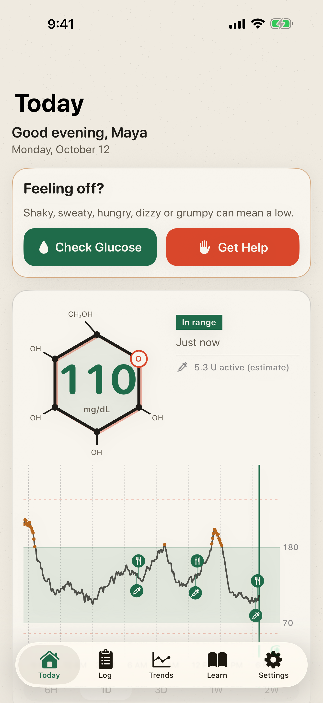
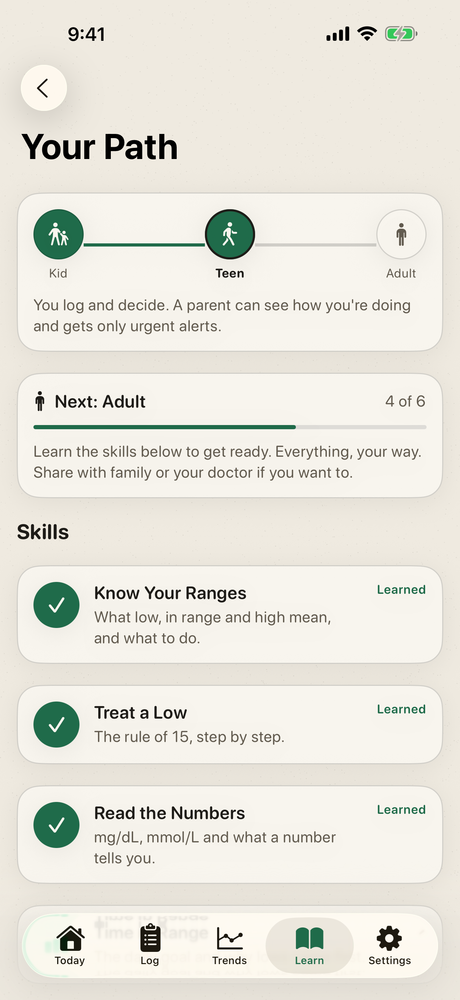
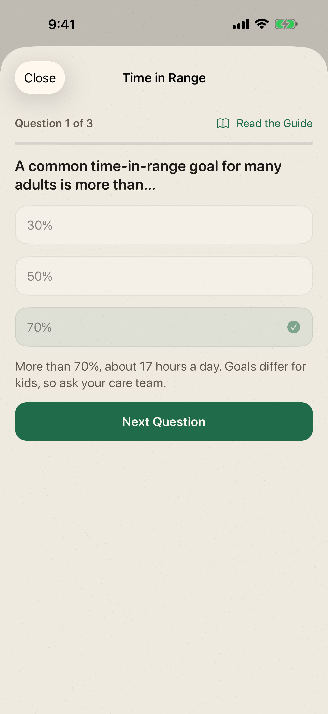
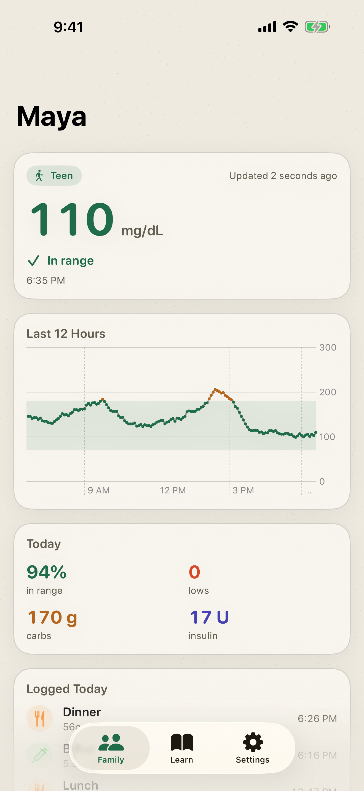

# DiabetesCare

A diabetes log for iPhone that grows with you.

My mom has type 1 diabetes. Watching her manage it every day made us think about kids who get diagnosed young: at first a parent does everything, and years later that kid has to do it all alone. Most diabetes apps are built for one adult. DiabetesCare is built for the years in between.

Made by Angad Kumar and Abhay for the 2026 Congressional App Challenge.

<p>
  
  
  
  
</p>

## How it grows

| | Kid | Teen | Adult |
|---|---|---|---|
| Who's in charge | A grown-up | The teen, with a parent watching | You |
| Logging insulin | Needs the grown-up passcode (until skills unlock it) | Open | Open |
| Changing ranges, clearing data | Passcode | Passcode | Open |
| Family alerts | Lows, highs, missing data, help requests | Urgent only | Urgent low only |

Kids move up by learning. Your Path has six skills: four short quizzes tied to the Learn guides (Know Your Ranges, Treat a Low, Read the Numbers, Time in Range) and two habits the app notices in the log (logging 7 days in a row, treating a low and checking again). Skills unlock things, and when a kid has them all a grown-up approves the move to Teen. Safety info like the low steps and Get Help is never locked.

## What it does

- Log glucose, carbs (5,371 foods from USDA FNDDS), insulin, ketones, activity and site changes. Reads CGM data from Apple Health.
- Today screen with the latest reading, trends, streaks and a plant that grows as you learn.
- Feeling off? A kid taps Get Help: find a grown-up, have 15 g of fast sugar, a 15-minute recheck timer on the Lock Screen, and Call or Text their grown-up.
- Trends, weekly recap and a PDF report for the doctor.
- Widgets, Live Activity, Siri shortcuts, Control Center buttons and an Apple Watch app.
- Family sharing: the person with diabetes shares read-only with family, and a parent's phone shows their readings and gets alerts.

## Privacy

Your health data is never sold, never used for ads and never sent to us. There is no account and no server. It stays on your phone, and the only people who ever see it are the family members you invite. Family sharing is end-to-end encrypted in your own iCloud (CloudKit `encryptedValues`), so not even Apple can read it. App Store privacy label: Data Not Collected. See [docs/privacy-policy.md](docs/privacy-policy.md).

**Not for dosing.** DiabetesCare is a log and a learning tool. It doesn't calculate insulin doses or replace advice from your care team.

## Honest status

- Family sharing over iCloud is built and tested with a stand-in transport, but it's switched off: iCloud needs a paid Apple Developer account, which we don't have yet. **See What Family Sees** in Settings › Family shows exactly what a parent would get. Turning it on is one script (`sh scripts/enable-icloud.sh`), see [docs/release-checklist.md](docs/release-checklist.md).
- The glossary, guides and quizzes are plain-language general information and still need a clinician's review.

## Build and run

Needs Xcode 26 and the iOS 26 and watchOS 26 simulator runtimes (`xcodebuild -downloadPlatform watchOS`).

```sh
open DiabetesCare.xcodeproj   # scheme DiabetesCare, run on an iPhone simulator
```

Tests:

```sh
xcodebuild test -project DiabetesCare.xcodeproj -scheme DiabetesCare \
  -destination 'platform=iOS Simulator,name=iPhone 17' -parallel-testing-enabled NO
```

Demo launch arguments (Debug builds; Edit Scheme › Run › Arguments):

| Argument | What it does |
|---|---|
| `-demoData` | Sample data for Maya, a teen, with a few skills done |
| `-demoData -stage kid` | Maya as a kid (grown-up passcode 1234) |
| `-demoFamily` | A parent's phone following Maya, with a sample urgent-low alert |
| `-resetSetup` | Show the "Who's using DiabetesCare?" setup again |

## Built with

SwiftUI, Core Data, HealthKit, WidgetKit, ActivityKit, App Intents, WatchKit/WatchConnectivity, CloudKit (sharing, off for now), TipKit, VisionKit, Swift Testing and XCUITest.

Project notes and history: [PLANNING.md](PLANNING.md).
